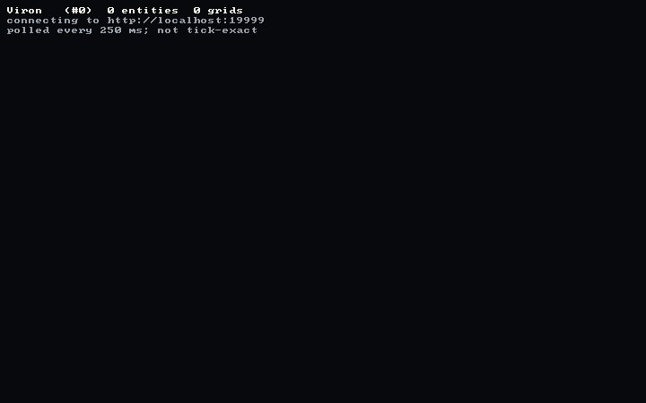
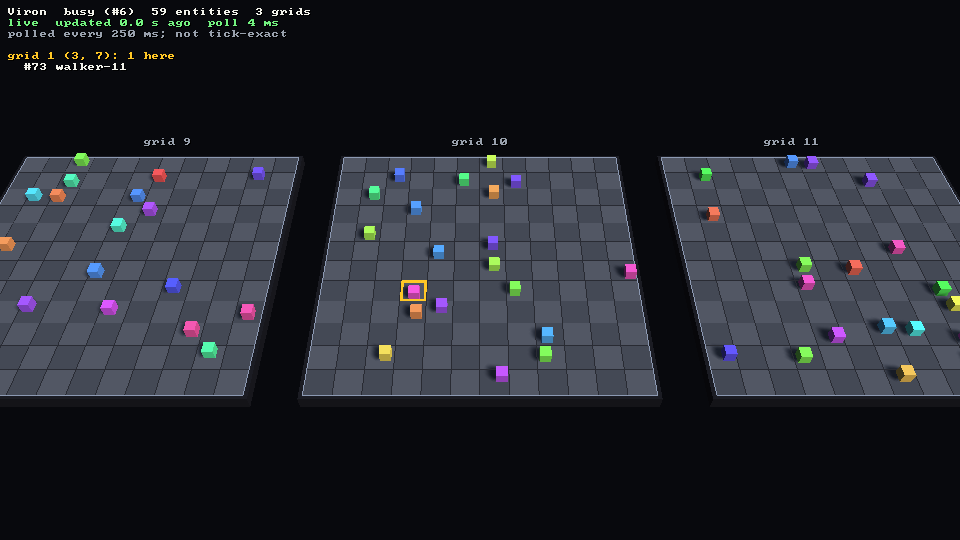
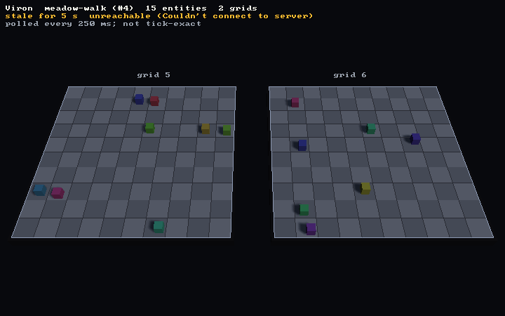
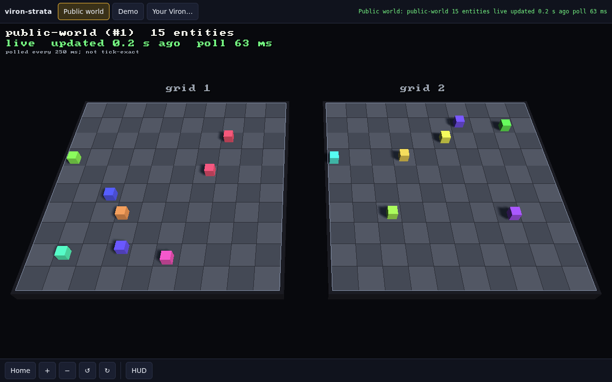
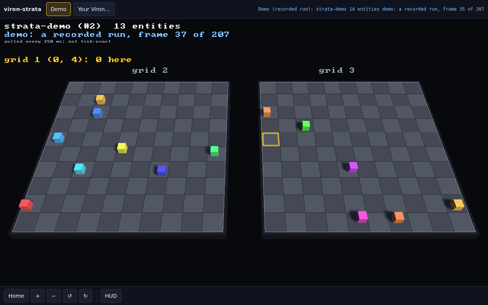
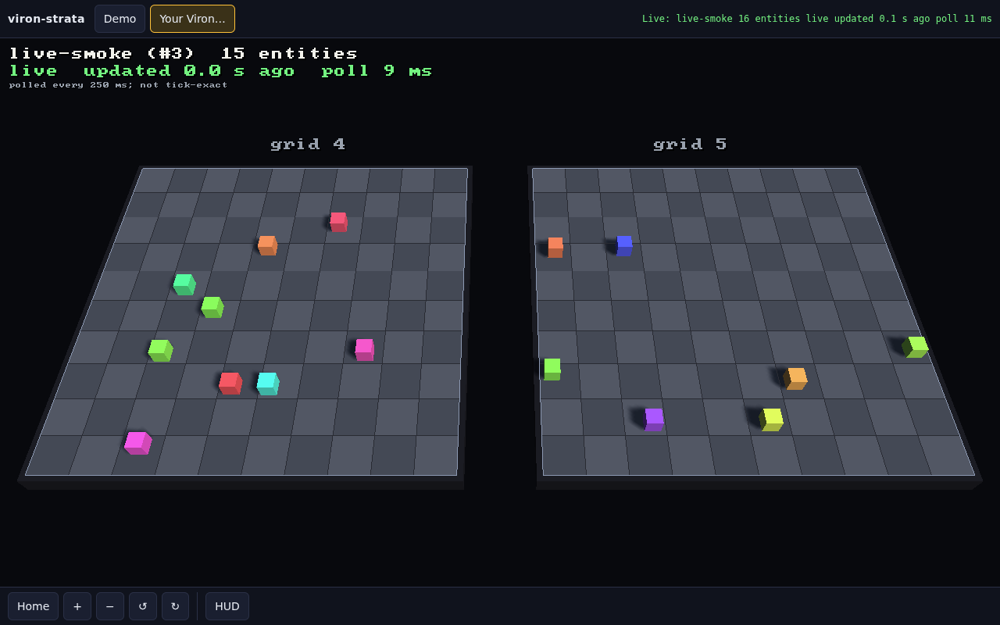
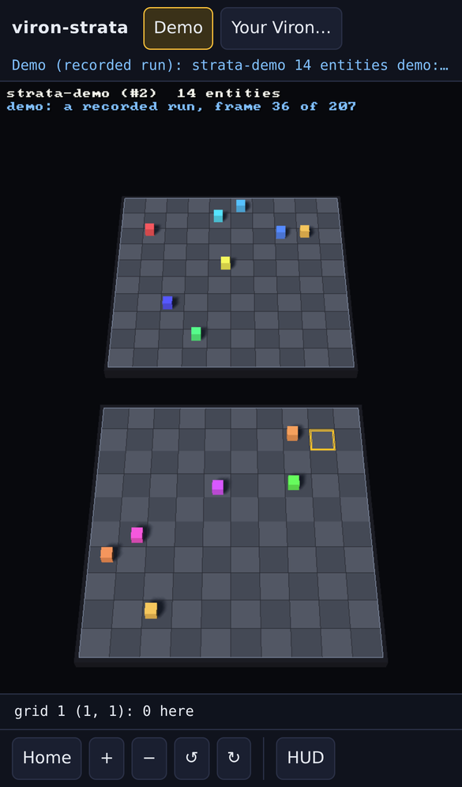

# viron-strata

A live, read-only 3D view of a [Viron](https://github.com/Preponderous-Software/viron) environment, drawn with the [Strata](https://github.com/Preponderous-Software/strata) engine. Point it at a Viron URL, a token and an environment. It polls Viron's REST API several times a second and shows grids and entities as a driver (a simulation, a script, a game) changes them.



*Recorded headlessly while [`tools/driver.py`](tools/driver.py) changed a local Viron: 16 entities on two grids. Each one steps to a free neighbouring cell every tick. Every few ticks one is taken off the grid (it shrinks out), a new one is placed (it grows in), or one is sent to the other grid (it snaps instead of sliding).*

| Three grids, 59 entities, one cell picked | Viron stopped: the view says so and dims |
|---|---|
|  |  |

**In a browser:** [viron-strata.play.danielstephenson.dev](https://viron-strata.play.danielstephenson.dev) opens on a **public Viron world** that a driver keeps moving, falls back to a recorded run when that server cannot be reached, and can watch your own Viron with a read-only token (see [In the browser](#in-the-browser)).

It implements RFC 0030 in [Preponderous-Software/rfcs](https://github.com/Preponderous-Software/rfcs). Its companion is [viron-usd](https://github.com/Preponderous-Software/viron-usd), which records a Viron run as OpenUSD for playback afterwards. viron-strata shows the run while it happens. The two use the same layout, so a live view and a recording of the same run line up.

## What it does

- **Read-only by construction.** The HTTP layer (`src/transport.h`) has one method, `get`, so the client has no way to send a write.
- **Light on Viron.** In the steady state each poll is a single request, `GET /api/v1/locations/placements?environmentId={id}`, which returns every placement from one consistent query. Grids are re-read every 20 polls and names every 40, and names are also fetched when a new entity id appears.
- **Smooth.** Each entity slides from its last polled cell to its new one over one poll period. A jump of more than one cell, or onto another grid, snaps. New entities grow in and removed ones shrink out.
- **Looks like the recording.** It uses viron-usd's conventions: one cell is one unit, grids sit side by side (`index × (rows + 2)`), and entities are 0.4 cubes. Each entity's offset within its cell and its colour both come from SHA-256 of its id. A conformance file generated from viron-usd's own `mapping.py` is checked in CI.
- **Honest about state.** The HUD says `live` (with the update age and poll latency), `Viron busy` (503 + `Retry-After`), `stale for N s` (5xx, timeout or refused: exponential backoff from 0.5 s to 10 s, with the last world kept on screen and dimmed), `token rejected` (401: it stops), `environment gone` (404: it stops), or that the Viron is too old to have `/locations/placements`. It also says the view is polled, not tick-exact.
- **Picking.** Click a cell to list the entities on it. Strata's raycast tests meshes, not primitives, so a click picks a cell rather than one cube.

## Build

CMake 3.24+, a C++17 compiler, libcurl (`libcurl4-openssl-dev`), and the X11/EGL development packages Strata's SDL3 build needs on Linux (see `.github/workflows/ci.yml`). Strata `v0.6.0` (pinned in `strata.ref`) and nlohmann/json 3.11.3 (pinned by SHA-256) are fetched at configure time.

```
cmake -S . -B build -DCMAKE_BUILD_TYPE=Release
cmake --build build -j4
ctest --test-dir build --output-on-failure
```

## Run

```
export VIRON_TOKEN=...            # a UserAuth JWT that Viron accepts
build/viron-strata --viron-url http://localhost:9999 --environment 4
build/viron-strata --environment "my world" --period-ms 100
```

`--environment` takes an id or a name. The token comes from `VIRON_TOKEN` or `--token`. These are the same names viron-usd uses, and `--url` is accepted for `--viron-url`. The token is never written to disk, logged or drawn. `https://` URLs are verified against the system's certificate store.

Window controls: drag or WASD/arrows pan, Q/E rotate, mouse wheel or +/- zoom, click a cell to list its entities, F re-frames, Tab toggles the HUD, Esc quits.

Headless (EGL surfaceless, so Mesa llvmpipe works without a display: `LIBGL_ALWAYS_SOFTWARE=1 GALLIUM_DRIVER=llvmpipe`):

```
build/viron-strata --environment 4 --headless --duration 15 --fps 10 --frames out/ --screenshot last.png
build/viron-strata --environment 4 --headless --duration 2 --verify
```

`--verify` waits for a fresh poll at the end, then compares the client's world with an independent `GET /locations/placements`. If they differ, or an entity is not drawn on its cell, it exits with status 1.

`--demo web/demo/recording.json` plays the recorded run the browser page uses, through the same poll loop, with no server.

## In the browser

The same client builds for the browser with Emscripten and Strata's WebGL 2 backend (`app/web_main.cpp`, `web/shell.html`). The page is published on arcade at **https://viron-strata.play.danielstephenson.dev**.



*The page as a visitor opens it: live on the public world while its driver moves the entities. Captured by `web/smoke/smoke.cjs --public` in headless Chromium.*

| Demo mode on a desktop | Watching a local Viron with a read-only token | iPhone 13 (cells stack when the screen is tall) |
|---|---|---|
|  |  |  |

*Captured by the smoke test (`web/smoke/smoke.cjs`) in headless Chromium.*

- **Public world** (the default): the page watches the `public-world` environment on a public Viron at `https://viron.play.danielstephenson.dev`, where a driver moves 16 entities across two 10x10 grids about once a second. Nothing needs typing in. The page carries that Viron's token, which is **read-only by design**: its scope is `viron:read`, so Viron answers `403` to any write made with it, and the public route passes only `GET`, `HEAD` and `OPTIONS` anyway. The page still never logs the token, stores it or puts it in the address bar, and CI fails the build if the bundle carries any JWT whose scope is not exactly `viron:read` (`tools/check_bundle_tokens.py`). If the public Viron does not answer within 5 seconds, or does not go live within 12, the page plays the demo instead and says why. The **Public world** button goes back to it.
- **Demo mode** (`#demo`, or the **Demo** button, or the automatic fallback): `web/demo/recording.json` is built into the page. It is a real run: [`tools/driver.py`](tools/driver.py) changed a throwaway local Viron for 50 seconds while [`tools/record_demo.py`](tools/record_demo.py) polled it with a read-only token and saved what Viron answered (format `viron-strata-demo/1`). The page plays it back through the client's own poll loop (`src/demo.h`), so it works for anyone, with no server and no token, and loops at the end.
- **Your Viron**: the "Your Viron…" form takes a URL, an environment (id or name), a token and a poll period. A link can carry them in the fragment, `#viron=https://viron.example.com&environment=4&token=...`, which never reaches a web server; the page reads the token and then removes it from the address bar. The token is kept only in the page's memory: it is not stored and is sent only to that Viron. No token is in the bundle.
  - The Viron must allow the page's origin: `VIRON_CORS_ALLOWED_ORIGINS=https://viron-strata.play.danielstephenson.dev` ([viron#244](https://github.com/Preponderous-Software/viron/issues/244)). It must be served over `https://`, because an https page cannot read plain http.
  - Use a **read-only token** (`scope: viron:read`, [viron#245](https://github.com/Preponderous-Software/viron/issues/245)), minted with Viron's `scripts/mint_read_token.py`. Viron answers it `403` on every write, so a token pasted into a page cannot change anything, wherever it ends up.
- **Read-only, as on the desktop.** In the browser, `src/async_poll.h` runs `PollCore`'s own step against the answers fetched so far. When it needs a path that has not been fetched, the page fetches it with `emscripten_fetch` (always `GET`) and tries the step again. Each step therefore makes the same requests, in the same order, as on the desktop, and handles every answer the same way. The unit tests check this request for request.
- **Touch**: drag pans, tap picks a cell (on a phone the cell's entities are listed under the view), and the buttons zoom, rotate and re-frame. The page caps the device pixel ratio at 2 and scales SDL's pointer units to drawable pixels (the asn1-viz#9 trap). The smoke test checks that a real tap picks the same cell as a direct pick at that point, on a desktop, an iPhone 13 profile (DPR 3) and a DPR-2 phone.

Build it:

```
emcmake cmake -S . -B build-web -DVIRON_STRATA_WEB=ON
cmake --build build-web -j4
ctest --test-dir build-web --output-on-failure   # the unit tests as wasm, under Node
```

The page is `build-web/viron-strata.html` (copy it to `index.html`) with `viron-strata.js` and `viron-strata.wasm`. `.github/workflows/browser.yml` builds it and runs the smoke test in demo mode. It also runs it opened as a visitor would open it, where the public Viron refuses CI's origin, so the page must fall back to the demo. Then it runs it in live mode against a real Viron (watched with a read-only token while the driver writes, plus a bad token that must stop the page). Finally it deploys the page to arcade from `main`. Against the public world itself, run the smoke test with `--public`. Add `--site-dir build-web-site` to serve a local build under the arcade origin that the public Viron's CORS allow-list names:

```
node web/smoke/smoke.cjs https://viron-strata.play.danielstephenson.dev/ out/public --public [--phone] [--site-dir <dir>]
```

## Trying it against a local Viron

[docs/LOCAL_VIRON.md](docs/LOCAL_VIRON.md) shows how to start a throwaway Viron, mint a token for it, and run [`tools/driver.py`](tools/driver.py), the demo driver that recorded the GIF above. The driver writes to Viron. viron-strata never does.

## Tests

- `[unit]`: the poll loop against a scripted fake Viron. That covers which requests each poll makes, steady-state cost, refreshing grids and names, the name fallback, 401, 404, 503 + `Retry-After`, backoff and recovery, an old Viron, and schema errors. It also covers tweening, snapping, growing and shrinking, and SHA-256 test vectors.
- `[conformance]`: offsets, colours, grid origins, cell centres, entity positions and floor face order, checked against `test/conformance/viron_usd_mapping.json`, which `tools/gen_conformance.py` generates from viron-usd's `mapping.py`. A CI job regenerates that file from viron-usd's `main` and fails if the conventions drift.
- `[render]` (EGL + GL 4.5): a fixed two-grid world compared with a golden image (16x10 block averages, so the test tolerates small rasteriser differences), picking cells on both grids, and batching more than 200 floors into one mesh.
- `[unit]` also covers the browser's `AsyncPoll` (the same requests and states as `PollCore`, one fetch at a time) and demo playback (frames follow the clock, the loop, the bundled recording).
- Integration (CI): a real Viron at a pinned commit on PostgreSQL 12. The driver changes it while the client watches with a read-only token, then `--verify` runs once the driver stops. A rejected token must stop the client.
- Browser (CI): the page in headless Chromium, in demo mode and against a real Viron (see [In the browser](#in-the-browser)).

## Not yet

- **Picking one cube** among several on a cell would need primitive raycasts in Strata, which would be a Strata change first.
- Push updates (SSE or WebSocket) and an `ETag` or revision counter on `/locations/placements` would make an idle world nearly free to watch. Both would be Viron changes.

## License

MIT. See [LICENSE](LICENSE).
